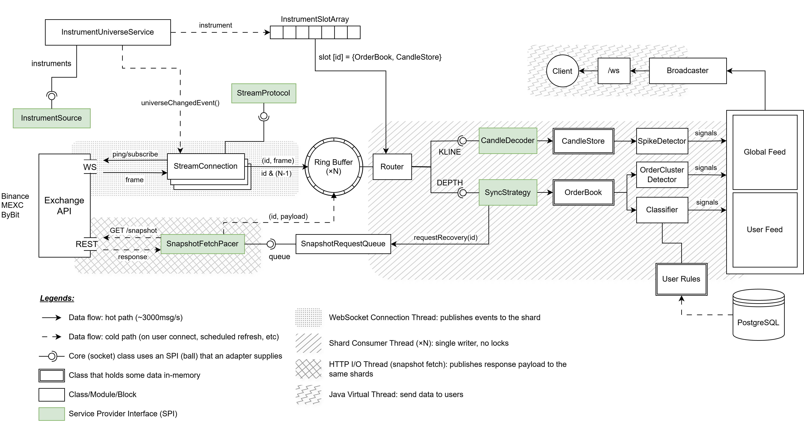
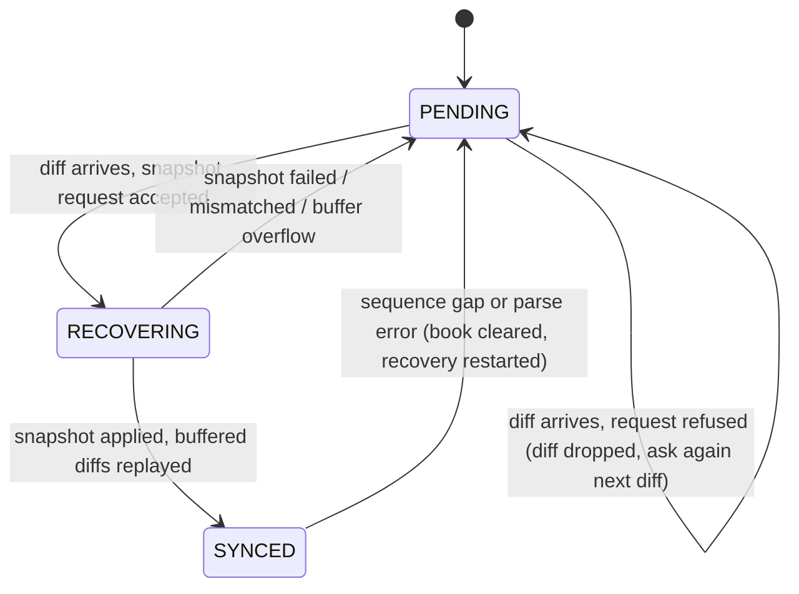

# Market-Data Pipeline — Architecture

**As of**: 2026-11-16.

This file explains **how the pipeline is designed and why**: the layers, the threading model, the
life of a message, and the rules that keep the hot path fast and correct. It is the document to read
first.

It does not repeat per-venue detail. That lives in
[`multi-exchange-progress.md`](multi-exchange-progress.md) (the current-state report: each adapter's
sequence rule, rate limits, config, known gaps). The two files split the work like this:

| File | Answers |
|---|---|
| **this file** | What are the parts, how do they fit, why is it shaped this way, how do I extend it |
| `multi-exchange-progress.md` | What exactly does each adapter do today, and what is still missing |

Where this file and the code disagree, the code is right. Section 12 lists what the target design
contains that is **not built yet**. Everything outside that section describes code that exists.

All code paths are relative to `src/main/java/dev/abu/screener_backend/`.

---

## 1. Purpose and forces

The pipeline keeps an accurate, local, in-memory copy of every tracked instrument's market state
(today: its order book) across several exchange venues, and turns that state into the signals sent to
clients.

Three forces shape every decision below:

1. **Rate.** Thousands of messages per second, and it only grows (table below). If processing falls
   behind arrival, the backlog grows until the exchange drops the connection as a slow consumer.
   Receiving a message must therefore be separated from processing it.

   **Measured today** (local run, 2026-11-15, 74 min, 2 shards; 3 exchanges, 5 of 6 venues, depth
   streams only, `MEXC_FUTURES` off):

   | Venue | Streams | Steady frames/s |
   |---|---|---|
   | `BINANCE_SPOT` | 351 | ~200 |
   | `BINANCE_FUTURES` | 519 | ~690 |
   | `MEXC_SPOT` | 508 | ~1,220 |
   | `BYBIT_SPOT` | 284 | ~430 |
   | `BYBIT_FUTURES` | 512 | ~1,000 |
   | **Total** | **2,174** | **~3,500** (range 2,600–4,400 at steady state, peak 5,250) |

   The shards kept up with headroom: the ring never dropped below 65,510 of 65,536 free slots, and
   the broadcaster's worst drain was 19 ms of its 100 ms budget. Per-venue figures are means over
   the samples where every book was `SYNCED`; the total is the sum of the two shards' msgs/s.

   **This is the floor.** It excludes `MEXC_FUTURES` (the largest MEXC venue) and every stream kind
   except depth. Each planned addition multiplies it: klines on every venue, trade streams on every
   venue, and further exchanges (e.g. Bitget). Plan for **4,500+ msg/s** (the Requirements Document
   figure) as the near-term ceiling and for well beyond it later. The `~3000 msg/s` label on the
   diagram is already below the measured rate. The Binance-only baseline of 844 msg/s is in
   `pipeline-benchmark-2026-09-08.md`.
2. **Heterogeneity.** Each venue has its own message format (JSON text or Protobuf binary), its own
   sequence-numbering rules, its own REST rate limits and its own recovery procedure. None of that may
   leak into shared code, or each new exchange would mean editing the core.
3. **Correctness.** A depth diff stream is only meaningful on top of a correct starting book. A lost
   or out-of-order message silently corrupts every later level, so the pipeline must detect gaps and
   heal itself without a restart.

The answers, in one line each:

- **Two layers**: a venue-agnostic *core* plus small venue-specific *adapters* that plug in through
  SPIs (§3).
- **Sharded single-writer processing**: raw frames go into LMAX Disruptor rings; each instrument is
  pinned to one shard with one consumer thread, so its state needs no locks (§5).
- **A sync state machine per book**, with REST snapshots fetched out-of-band and delivered back
  through the same ring (§6).

---

## 2. The big picture



*Source: `.claude/docs/images/marketdata_pipeline.drawio.png`. The diagram shows the target design,
including parts that are not built yet; §2.2 maps each box to the code.*

### 2.1 Reading the diagram

- **Solid arrows** are the hot path. **Dashed arrows** are the cold path (user connect, scheduled
  refresh, snapshot HTTP).
- **Green boxes** are SPIs: contracts the core consumes and an adapter supplies. The ball-and-socket
  symbol means "core (socket) uses an SPI (ball)".
- **Double-bordered boxes** hold in-memory state (`OrderBook`, `CandleStore`, `User Rules`).
- **The four shaded zones are four thread kinds.** This is the most important thing the diagram says:
  - *dotted*: WebSocket connection thread, publishes events to a shard
  - *diagonal hatch*: shard consumer thread (×N), **single writer, no locks**
  - *cross hatch*: HTTP I/O thread (snapshot fetch), publishes the response to the same shards
  - *zigzag*: Java virtual thread, sends data to users

### 2.2 Diagram box → code

| Diagram box | Code | State |
|---|---|---|
| `InstrumentUniverseService`, `instrument`, `universeChangedEvent()` | `marketdata/InstrumentUniverseService`, `InstrumentUniverseChangedEvent` | built |
| `InstrumentSource` (SPI) | `spi/InstrumentSource` + one per exchange | built |
| `InstrumentSlotArray`, `slot[id]` | `core/slot/InstrumentSlotTable`; `InstrumentSlot = {instrument, book, syncStrategy, syncCtx, tradeDecoder, trade}` | built (no `CandleStore` yet) |
| `StreamConnection` (×N), `ping/subscribe` | `core/stream/StreamConnection`, `ConnectionPool` (one per `StreamKey`), `StreamManager` | built |
| `StreamProtocol` (SPI) | `spi/StreamProtocol`, bound per stream (`StreamKey`) | built |
| `Ring Buffer (×N)`, `(id, frame)` | `core/ingress/DisruptorShardManager`, `DisruptorMarketEventPublisher`, `MarketEvent` | built |
| `Router` (`KLINE` / `DEPTH`) | the `switch (event.stream)` in `core/ingress/MarketEventHandler`; `marketdata/StreamKind` | built, `DEPTH` and `TRADE` arms (a `default` arm counts kinds with no arm) |
| `TradeDecoder` (SPI) → trade sink | `spi/TradeDecoder` + `spi/TradeSink`, bound per venue (`VenueTradeDecoderBinding`); `adapter/binance/BinanceAggTradeDecoder`; `core/trade/TradeDetector` | built for Binance; the detector counts decoded trades, coalesces sweeps in the slot's `TradeState` and alerts on sweeps at or above `TradeThresholds` |
| `SyncStrategy` (SPI) → `OrderBook` | `spi/DepthSyncStrategy` + one per venue; `core/book/OrderBook` | built |
| `requestRecovery(id)`, `SnapshotRequestQueue` | `spi/RecoverySink`, `core/recovery/SnapshotRequestQueue` | built |
| `SnapshotFetchPacer` (SPI) | `spi/SnapshotFetcher` + one per venue | built |
| `Classifier`, `User Rules` | `analysis/OrderBookClassifier`, `analysis/rule/*`, `analysis/UserClassificationContext` | built |
| `Global Feed`, `User Feed` | `feed/depth/OrderBookFeedStore` (one global, one per user context) | built |
| `Broadcaster`, `/ws`, `Client` | `feed/FeedBroadcaster`, `ws/ScreenerWebSocketEndpoint`, `ws/UserWebSocketSession` | built |
| `CandleDecoder` (SPI), `CandleStore`, `KLINE` branch | n/a | **planned** (§12) |
| `SpikeDetector`, `OrderClusterDetector` | n/a | **planned** (§12) |

The word "pipeline" covers everything from the exchange socket to the `/ws` client. Sections 3–7
cover ingest and state (the part that ends at a `SYNCED` book). Section 8 covers classification and
delivery.

---

## 3. Two layers: core and adapters

```
          ┌────────────────────────── core (venue-agnostic) ───────────────────────────┐
          │  discovery merge · connection pools · ring buffers · slot table · books    │
          │  snapshot queue · classification · feed · WebSocket server                 │
          └───────────────▲──────────────▲───────────────▲───────────────▲─────────────┘
                          │ SPI          │ SPI           │ SPI           │ SPI
                   InstrumentSource  StreamProtocol  DepthSyncStrategy  SnapshotFetcher
                          │              │               │               │
          ┌───────────────┴──────────────┴───────────────┴───────────────┴─────────────┐
          │  adapter/binance        adapter/mexc        adapter/bybit        (next…)    │
          └────────────────────────────────────────────────────────────────────────────┘
```

**Venue** (`Exchange` + `Market`: `BINANCE_SPOT`, `MEXC_FUTURES`, …) is the adapter unit. Each venue
is plugged into the shared pipeline by implementing the SPIs below. Core never imports an adapter
class: `spi/` sits beside both and is inside neither.

### 3.1 The SPIs

| SPI | What the adapter decides | What core keeps |
|---|---|---|
| `InstrumentSource` | How to fetch the venue's tradable instruments and which are eligible (quote asset, contract type, status) | Merging all sources, per-source failure isolation, exclusion list, id assignment, enable switches |
| `StreamProtocol` | Per stream (venue + kind): the channel, subscribe frame format, how a raw frame maps to an instrument (`route`), heartbeat kind | Connections, chunking, fan-out, reconnect with backoff, resubscribe, scheduling the heartbeat, tagging each frame with the connection's kind |
| `DepthSyncStrategy` | Parsing diffs and snapshots; the sequence-continuity rule; when to ask for recovery | Calling it on the shard thread, owning the book, the `PENDING → RECOVERING → SYNCED` states' storage |
| `SnapshotFetcher` | Snapshot endpoint, request cost, pacing, rate-limit and ban handling | Queueing, batching, the exactly-one-outcome guarantee, publishing results into the ring |
| `CandleDecoder` | *(planned)* Parsing kline frames into a normalized candle | |

Each SPI is bound through a `Venue*Binding` bean built by that exchange's single `@Configuration`
(`BinanceAdapterConfig`, `MexcAdapterConfig`, `BybitAdapterConfig`). Most are bound per venue.
`StreamProtocol` is bound per **stream**: `VenueStreamBinding(StreamKey, StreamProtocol)`, where
`StreamKey = (Venue, StreamKind)`, because one connection carries one kind (§5.1). Core assembles
registries from the bindings and **fails startup** on a duplicate binding or an enabled venue (for
protocols: an enabled stream) with no binding. A protocol bound for a disabled stream is accepted,
so an adapter can ship a kind dark. Adapter classes are constructed in that config and are
deliberately not `@Component`s.

### 3.2 Where the line is drawn

The dividing rule is **"what differs per exchange is an SPI, what is common is core."** A few
placements that are not obvious:

- *Snapshot pacing is the adapter's, snapshot queueing is core's.* Binance prices requests by
  weight, MEXC and Bybit pace at a fixed interval, Bybit shares one cooldown across two venues. None
  of that is in core, which only queues, batches and guarantees one outcome per request.
- *Eligibility filters are hardcoded in each adapter.* They define what the pipeline can handle for
  that venue, so they are not configuration.
- *Parsing is the strategy's.* There is no normalized cross-exchange DTO. A strategy parses a diff
  and applies it to the book in one streaming pass, because building a neutral message object per
  frame is exactly the allocation the hot path cannot afford.
- *Books hold base-asset quantity.* A venue whose wire unit differs (MEXC futures contracts) converts
  at parse time through `Instrument.quantityMultiplier`, so the classifier never sees venue units.

---

## 4. Startup and identity (cold path)

```
@Scheduled refresh ──► InstrumentUniverseService.refresh()
                         │  fetch every InstrumentSource concurrently (virtual threads, one deadline)
                         │  isolate failures, drop disabled venues, apply exclusion list
                         ▼
        1. register all instruments → dense int ids         (InstrumentRegistry)
        2. InstrumentSlotTable.allocate(each)               (book + strategy + sync ctx per id)
        3. InstrumentSlotTable.publish()                    (one volatile store)
        4. fire InstrumentUniverseChangedEvent
                         ▼
        StreamManager: first event for a venue ─► one ConnectionPool per enabled stream ─► subscribe
```

The order of steps 1–4 is an invariant: if a subscribe went out before `publish()`, a frame could
resolve an id past the end of the slot array.

**Identity.** The pipeline key is a **dense process-local `int`**, not `(symbol, market)`. The same
`BTCUSDT` is a different instrument on each venue, with its own id and its own book. The id is an
array index, so the consumer reaches an instrument's state with one array read and no hashing or
string building. It is never persisted and never put in a payload; `(venue, nativeSymbol)` is the
durable identity. Each `Instrument` also carries four precomputed strings (`symbol`, `ruleKey`,
`feedKey`, `logName`), so no key is built per message. Details: `multi-exchange-progress.md` §3.

---

## 5. The hot path: from socket to shard

### 5.1 Life of a message

```
 exchange WS (one connection = one StreamKey = one kind)
     │  text or binary frame
     ▼
 StreamConnection.onMessage            ── WebSocket reader thread (one per connection) ──
     │  id = protocol.route(frame, SubscriptionIndex)       ← adapter SPI, no allocation
     ▼
 DisruptorMarketEventPublisher.publishFrame(kind, id, frame)   ← kind is the connection's final field
     │  ring = rings[id & (shards - 1)]
     │  slot = ring.next();  fill source/stream/id/payload;  ring.publish()
     ▼
 ┌──────────── ring buffer, one per shard (power-of-two slots) ────────────┐
 └────────────────────────────────┬─────────────────────────────────────────┘
                                  ▼
 MarketEventHandler.onEvent             ── disruptor-shard-N consumer thread (the only writer) ──
     slot = slotTable.get(id)
     switch (event.stream):  DEPTH ─►  slot.syncStrategy().onEvent(slot, event)   ← parse + sync + book
                                       classifier.process(instrument, book)        ← only if SYNCED
                             default ─► count + WARN at most once a minute (kind with no arm)
     event.clear()
```

The connection thread does the minimum: ask the protocol which instrument the frame belongs to, then
publish the **raw, unparsed** frame. Everything expensive (parsing, sequence check, book mutation,
classification) happens on the shard thread, in parallel across shards.

**One connection carries one stream kind.** The transport unit is a `StreamKey = (Venue, StreamKind)`:
one `ConnectionPool` per key, every connection in it subscribed to one channel, and the kind is a
`final` field of the connection, never parsed from the frame. Venues require it (Binance futures
serves trades and klines on a different endpoint from depth; MEXC spot's 30-subscription cap would
be split between kinds), it keeps `route()` and `SubscriptionIndex` unchanged, and a high-rate kind
gets its own sockets, heartbeats and reconnects. The cost is more sockets per venue.

Why raw frames and not parsed objects: parsing on the reader thread would put the venue's slowest
step on the thread that must keep up with the socket, and any normalized object would be allocated
per message. Text frames travel as `MarketEvent.rawJson`, binary frames as `rawBytes`, without a
copy (java-websocket allocates a fresh buffer per frame, and `JavaWebSocketBufferOwnershipTest` pins
that).

### 5.2 The ring event

`MarketEvent` is a reused mutable ring slot (never allocated per message) with five fields:

| Field | Meaning |
|---|---|
| `source` (`EventSource`) | **Provenance**: `WS_MSG`, `REST_MSG`, `REST_FAILED`. Drives the strategy's parse path and backpressure: REST events are never dropped, because each is the single outcome of a request |
| `stream` (`StreamKind`) | **What the payload is**, taken from the publishing connection; the consumer dispatches on it. `DEPTH` and `TRADE` today (`TRADE` bound for Binance only, decoded in its arm by the slot's `TradeDecoder`), `KLINE` planned |
| `instrumentId` | Dense id |
| `rawJson` / `rawBytes` | At most one payload; fixed per venue by its wire protocol |

`source` and `stream` are orthogonal on purpose. `source` says where bytes came from, `stream` says
what they mean, and whether a payload is a snapshot is the strategy's call. Bybit relies on this: a
`WS_MSG` can be a full book.

### 5.3 Sharding and the single-writer rule

- **N shards** (`screener.disruptor.shard-count`, a power of two, validated at startup). Each is one
  `Disruptor<MarketEvent>` with `ProducerType.MULTI`, one dedicated consumer thread
  (`disruptor-shard-N`) and its own `OrderBookClassifier`.
- **Instrument → shard is `id & (N - 1)`.** Dense ids make this a mask, spread evenly, with no
  hashing. Every producer goes through `DisruptorMarketEventPublisher`, the only fill-and-publish
  site, so this expression exists in exactly one place and an instrument's events can never split
  across shards.
- **Why that matters.** All events for one instrument land on one thread, in order. So an instrument's
  book, sync context and classification state are **single-thread-owned**: no `synchronized`, no
  locks, no atomics on the data path, and per-instrument ordering is free. Shards run in parallel
  with each other and share nothing mutable.

Both kinds of producer publish through the same expression: the WebSocket reader threads (`WS_MSG`)
and the HTTP I/O threads that deliver snapshots (`REST_MSG` / `REST_FAILED`).

### 5.4 Backpressure

The publisher claims with the **blocking** `rb.next()`. A full ring stalls the producer, and for
`WS_MSG` the producer is a reader thread, so the whole connection stalls. That is a deliberate
choice for now: ring free capacity is exported in the health log (it should sit at the ring size at
steady state), and a stalled reader pushes back to TCP instead of dropping data silently. The planned
change (non-blocking `tryNext()` plus a reset flag) is in §12.

### 5.5 Publication of shared structures

- `InstrumentSlotTable` is a copy-on-write `InstrumentSlot[]` published with one `volatile` store.
  The discovery thread builds a private staging copy and publishes it all at once; the hot path only
  reads. `get(id)` bounds-checks and returns `null` rather than throwing; the handler counts and
  drops such an event (it should never occur).
- `OrderBook.state` is `volatile` only because the health logger reads it from another thread.
- The per-user classification contexts are swapped atomically as one array reference
  (`setActiveUserContexts`), read once per `process` call.

---

## 6. Order-book sync and recovery

Depth streams are **diffs**. A book is only correct if it starts from a snapshot and every diff after
it follows the previous one. Each book is therefore a small state machine, driven only on the shard
thread.



(See also `images/order_book_state_machine.drawio.png` and `images/order_book_seq_diagram.drawio.png`.)

### 6.1 The recovery loop

```
 shard thread            SnapshotRequestQueue          snapshot-queue thread      HTTP thread
 ────────────            ────────────────────          ─────────────────────      ───────────
 PENDING book, diff
   requestRecovery(slot) ─► accept (lock-free CAS)  or  refuse
   accepted: RECOVERING,                                   tick():
   buffer this diff                                          drain batch ─► SnapshotFetcher.fetchAll
   later diffs: buffer                                                         GET /snapshot (paced)
                                                                               response / failure
                         ◄──── ring event: REST_MSG (body) or REST_FAILED ◄─────┘
 handleSnapshot: load levels,
   replay buffer through the sequence check ─► SYNCED
 REST_FAILED: ─► PENDING (no re-request; the next diff asks again)
```

The decisions that make this robust:

- **Every book-state change happens on the shard thread.** The snapshot result is not written into
  the book by the HTTP thread; it is published into the same ring as a `REST_MSG` / `REST_FAILED`
  event and consumed by the owning shard. This keeps the single-writer rule intact and removes any
  race between a late snapshot and a live diff.
- **Refusal is the back-off.** `requestRecovery` may refuse (a batch is in flight, the queue is full,
  or the fetcher is out of rate-limit budget). A `PENDING` book then drops the diff and asks again on
  its next diff (≤ 1 s later), so no book is stranded and **core needs no timers or retry logic**.
  A snapshot failure also just returns the book to `PENDING`.
- **Exactly one outcome per accepted request.** `BatchOutcome` guarantees it (a fetcher that throws,
  times out or forgets a slot is failed by core), so a book can never be left in `RECOVERING` with
  nothing in flight.
- **State guard.** A `REST_*` event for a book that is not `RECOVERING` is dropped, so a late or
  duplicate outcome cannot touch a book that is not waiting.
- **Self-healing.** Gaps, parse errors, buffer overflow, failed snapshots and reconnects all end in
  the same place, `PENDING`, which restarts the loop. No manual action or restart is needed.
- **Only `SYNCED` books produce output.** The classifier gates on it, so a half-built book is never
  shown to a user.

What differs per venue is only *how continuity is checked and how the first book is obtained*
(Binance and MEXC: REST snapshot plus buffered-diff stitching; Bybit: the first frame of each
subscription is already the full book and REST is only a gap fallback). That lives in the
`DepthSyncStrategy` and `SnapshotFetcher` of each adapter. The shared contract every strategy
follows is `multi-exchange-progress.md` §7.

---

## 7. State stores

- **`OrderBook`**: pure storage. Two `TreeMap<Double, PriceLevelEntry>` (bids reverse-ordered, asks
  natural), owned by the shard thread. A zero quantity removes the level; an existing level is
  updated in place. After each applied batch `computeDistance()` recomputes mid, drops everything
  beyond ±`screener.orderbook.price-filter-threshold` (0.1) and stores each survivor's `distance`
  as a fraction of mid. `PriceLevelEntry.firstSeenMillis` records level age. No venue, sequence or
  parsing logic lives here.
- **`InstrumentSlot`**: the per-instrument runtime record: `(instrument, book, syncStrategy,
  syncCtx)`. The strategy is resolved once at allocation and pinned in the slot, so the consumer
  never walks `id → venue → strategy`. The target design adds a `CandleStore` here.
- **`BookSyncContext`**: opaque, adapter-owned per-book sync state (buffered diffs, sequence
  cursor). Core never inspects it.

The full book, bounded only by the price filter, is retained so that wide custom user rules can still
see far levels, even though the default rule shows less.

---

## 8. Classification and delivery

### 8.1 Classification (shard thread)

After a depth event, `OrderBookClassifier.process(instrument, book)` runs in the same consumer
thread, on a book that is `SYNCED`. One classifier instance exists per shard and is never shared.

- **Default pass**, always: global tier rules, writes the **global** feed store.
- **Per-user pass**, only for connected users with a rule for this `ruleKey`: that user's own rule
  and state, writes the user's **personal** feed store. Contexts are an atomically swapped array, so
  with no custom users connected the cost is one volatile read.
- Each pass selects the top 5 levels per side ranked by `(tier DESC, notional DESC, distance ASC)`
  and a per-symbol `LOW`/`HIGH` activity machine decides whether to emit `ADD`, `UPDATE` or `DROP`.
  No `ClassifiedLevel` is allocated for the `LOW` majority of books.

Rules are exchange-independent (`ruleKey` = `base + quote : MARKET`), while classification state and
feed entries are per venue (`feedKey`). So one user rule applies to a symbol on every exchange, and
each exchange's book is still classified and delivered separately. Full detail:
`orderbook-classification.md` (its file paths are partly stale; trust the code).

### 8.2 Feed stores and the broadcaster

```
 shard threads ──► OrderBookFeedStore.add(update)        (global store + one per user context)
                       pending map  (coalesces per feedKey, swapped atomically on drain)
                       snapshot map (current state, for new clients)
                                      │
 FeedBroadcaster @Scheduled(100 ms) ──┤  one thread; for each FeedChannel: drain() once
                                      │  for each session: snapshot (new) or updates (ready)
                                      ▼
                       UserWebSocketSession.enqueueBatch  ──►  bounded queue (32 batches)
                                      ▼
                       virtual-thread send loop  ──►  /ws client
```

- **Stores are the hand-off between the shard threads and the broadcaster.** Shards write; the
  broadcaster drains. The pending map coalesces, so ten updates to one instrument inside a 100 ms
  window become one message.
- **`FeedBroadcaster`** is a fixed-delay loop over a list of **`FeedChannel`** beans. Each channel
  drains its own stores and builds the tick's bodies once; the broadcaster owns only the per-session
  loop. `DepthChannel` is the one channel today and merges the global feed with each custom-rules
  user's personal feed (a session gets exactly one authoritative update per instrument per tick).
  A new signal type adds a channel bean; the broadcaster does not change.
- **Per-session backpressure.** A session has a bounded queue and a virtual-thread sender. A batch
  that cannot be enqueued **evicts** the session (it is disconnected, never skipped), because gap-free
  delivery depends on it; the client reconnects and receives a fresh snapshot. A slow client therefore
  cannot slow the shards or any other client.
- **Entitlement gates the entry.** `EntitlementService.hasAccess` is checked in the WebSocket
  `@OnOpen` and on every `/api/rules` endpoint; admins bypass it. A rule edit rebuilds that user's
  context, retargets connected sessions and pushes a fresh snapshot with no reconnect.

---

## 9. Threads and ownership

| Thread | Created by | Owns / does |
|---|---|---|
| java-websocket reader (one per connection) | `StreamConnection` | route a frame, publish it into the ring |
| `reconnect-<venue>-<kind>` (lower case, e.g. `reconnect-binance_futures-depth`) | `ConnectionPool`, one per stream | reconnect backoff, heartbeats |
| `disruptor-shard-N` | `DisruptorShardManager` | **the only writer** of its instruments' books, sync contexts and classification state; strategy + classifier |
| `snapshot-queue` (daemon) | `SnapshotQueueFactory` | ticks every venue's queue; dedicated so a blocked discovery refresh cannot stall it |
| Reactor / Netty | REST clients, fetchers | HTTP I/O; fixed-interval pacing on `Schedulers.parallel()`; publishes outcomes into the ring |
| Spring `@Scheduled` | Spring | discovery refresh, `FeedBroadcaster` 100 ms drain, `PipelineHealthLogger` 30 s |
| virtual threads | `InstrumentUniverseService`, `UserWebSocketSession` | one per source fetch; one per client send loop |
| Tomcat | Spring | REST and WebSocket connect/disconnect (cold) |

Three cross-thread seams are the only places state is shared, each by an explicit mechanism: the ring
buffer (producers → shard), the volatile-published slot array and user-context array (cold → hot),
and the feed stores' coalescing maps (shard → broadcaster).

---

## 10. Performance rules

These apply to the hot path only: `marketdata/core/{stream,ingress,slot,book,recovery}`, the adapters'
strategies and protocols, `feed/`, and the `analysis/` classifier. The authoritative list is in
`CLAUDE.md`; the reasons are in the design above.

| Rule | Why |
|---|---|
| No allocation in `onMessage` / `onEvent` | Allocation rate turns into GC pauses that stall shards; ring slots and sync buffers are reused |
| Primitive `double`, no `BigDecimal` | Precision is ample for a screener; boxing and `BigDecimal` dominate the cost otherwise |
| Jackson streaming `JsonParser`, in place; hand-written Protobuf wire reader | Extract only the levels and sequence fields; never build a POJO for a diff |
| Absolute `ByteBuffer` indexes | A routed buffer is read on two threads without a copy |
| No INFO+ logging per message | Log volume at this rate is its own bottleneck |
| `TreeMap`s single-thread-owned | Locks would be the contention point; ownership removes the need |

The rest of the codebase (auth, billing, payment, REST) is ordinary Spring MVC + JPA and does not
inherit these rules.

---

## 11. Failure behaviour

| Failure | Detected by | Behaviour |
|---|---|---|
| Sequence gap on a `SYNCED` book | strategy `check()` → `DE_SYNCED` | book cleared → `PENDING`, recovery restarted |
| Frame cannot be parsed | strategy throws | same as a gap |
| Diff buffer overflow while `RECOVERING` (500) | strategy | `recover()` |
| Snapshot HTTP error, timeout, rate-limit | fetcher / `BatchOutcome` | `REST_FAILED` → `PENDING`; book asks again, refused while the fetcher is pausing |
| Venue rate-limits or IP-bans | fetcher | fetcher stops accepting (cooldown); requests are refused, nothing is sent |
| WebSocket drop | `StreamConnection` | reconnect with exponential backoff, resubscribe; Binance/MEXC books resync on the first non-continuing frame, Bybit books are replaced by the new in-stream snapshot |
| Discovery source fails | `InstrumentUniverseService` | that source's venues keep their previous universe; others unaffected |
| A stream's pool fails to start | `StreamManager` | logged; the venue's other streams and other venues unaffected |
| An enabled venue has no enabled stream (e.g. a config file still using the pre-`streams.<KIND>` flat keys) | `ExchangesProperties` | startup fails, pointing at `streams.DEPTH` |
| A bound, streaming kind has no handler arm | `MarketEventHandler` `default` arm | event counted and dropped, WARN at most once a minute |
| Ring full | blocking `next()` | the reader thread stalls (TCP backpressure) |
| Slow client | bounded session queue | session evicted, client reconnects to a fresh snapshot |

The known holes in this table are tracked in `multi-exchange-progress.md` §13: no reset lane (a
reconnect cannot invalidate a book from outside the shard), blocking ingress, no staleness watchdog,
no dynamic subscribe, no startup retry for discovery.

---

## 12. Planned (not built)

The diagram and the Requirements Document show the pipeline with additional stream kinds and signals.
Today `DEPTH` is fully built and `TRADE` is streamed, decoded and coalesced into sweeps that are judged against per-symbol thresholds. The seams for the rest
are already in place:

| Planned | Seam already built | Where it is designed |
|---|---|---|
| **Kline streams**: `KLINE` stream kind, `CandleDecoder` SPI, `CandleStore` in `InstrumentSlot`, `KLINE` arm in `MarketEventHandler`, Binance futures `/market` endpoint | `StreamKind`, the dispatch `switch`, `MarketEvent.stream`, generic `MarketEventPublisher`, **transport keyed by `StreamKey`** (per-stream pools, protocol bindings, `streams.<KIND>` config, per-kind frame counters) | `.claude/plans/team-plans/spike-alerts-plan.md`; the generalization steps, already done, are `.claude/plans/market-event-generalization-plan.md` and `.claude/plans/multi-stream-transport-plan.md` |
| **Trade streams**: Bybit and MEXC trade protocols and decoders; a shard tick to flush sweeps on quiet symbols | **transport, decoding and sweep detection done**: `StreamKind.TRADE`, Binance spot and futures `@aggTrade` bindings (`BinanceStreamProtocol.aggTrade`, futures on `/market/ws`), `streams.TRADE` blocks (on by default); the `TradeDecoder` SPI with `BinanceAggTradeDecoder` pinned in the slot; the `TRADE` arm decodes into `TradeDetector`, which counts decoded trades, folds the fills of one taker order into a sweep held in the slot's `TradeState` (same side and trade time, price moving toward the aggressor, contiguous ids), and judges each sweep, once the instrument's next trade closes it, against `screener.trade-alerts` (a $30K floor plus per-symbol overrides from the slice 0 capture), into the in-memory `TradeAlertStore` behind `/api/monitoring/trade-alerts` | `.claude/plans/trade-alerts-plan.md`; Phase 1: `.claude/plans/trade-streams-transport-plan.md`; Phase 2: `.claude/plans/trade-detection-plan.md` (slices 0–3 done; slice 4, the tick, deferred) |
| **`SpikeDetector`** (price and volume spikes from candles) | `FeedChannel` interface for delivery | `spike-alerts-plan.md` |
| **`OrderClusterDetector`** (split-order walls across adjacent levels) | depth arm of the handler; `FeedChannel` | `.claude/plans/team-plans/order-cluster-plan.md` |
| **Trade alerts** (large trades): delivery to users | detection and `TradeAlertStore` (trade streams row above); `FeedChannel` | `.claude/plans/trade-alerts-plan.md` (Phase 2 detection done; Phase 3 delivery next) |
| Non-blocking ingress with reset lane | `DisruptorMarketEventPublisher` is the single place for the change | `multi-exchange-progress.md` §13 |
| Primitive-array book store replacing `TreeMap<Double,…>` | none (the classifier reads `getBids()` / `getAsks()` directly) | `CLAUDE.md` Future Work |

---

## 13. Extending the pipeline

**Add an exchange.** One new `adapter/<name>/` package with a single `@Configuration`, a YAML block
under `screener.exchanges.<name>`, an `Exchange` constant and `Venue` constants. The config supplies
an `InstrumentSource`, a `VenueStreamBinding` per stream (→ `StreamProtocol`; `DEPTH` at least, with
its transport settings under `venues.<MARKET>.streams.DEPTH`), a `VenueStrategyBinding`
(→ `DepthSyncStrategy` + `BookSyncContext`), and, if it recovers over REST, a `SnapshotFetcher`
handed to `SnapshotQueueFactory`. **No core edit.** Checklist and the seams Bybit exercised:
`multi-exchange-progress.md` §12.

**Add a stream kind** (trades, klines). The recipe:

1. Add the `StreamKind` value (`marketdata/StreamKind`).
2. Add a `streams.<KIND>` block under each venue that will stream it, in `application.yml`
   (`screener.exchanges.<exchange>.venues.<MARKET>.streams.<KIND>`), with `enabled: false` until it
   is ready. A missing block or `enabled: false` keeps the stream off.
3. Add a `StreamProtocol` per venue for the new channel and bind it with
   `VenueStreamBinding(new StreamKey(venue, KIND), protocol)`. Where the exchange's control frames
   (subscribe, ack, heartbeat, error) are the same as for depth, reuse its protocol class and pass the
   channel in (Bybit's topic prefix, Binance's topic suffix) instead of copying it.
4. Add a decoder SPI, bound per venue. For kinds that need no sync, the adapter **only decodes**: it
   parses the frame in place and reports each item to a core-owned sink as primitives (one callback
   per trade or candle update, so a batched frame needs no allocation), converting quantities through
   `Instrument.quantityMultiplier`. **Core owns the state.** Depth stays the only kind with an
   adapter-owned sync strategy: a trade-like kind adds a decoder binding, not a sync strategy.
   `TRADE` is the worked example: `spi/TradeDecoder` → `spi/TradeSink` (core's
   `core/trade/TradeDetector`), bound with `VenueTradeDecoderBinding` and collected by
   `TradeDecoderRegistry`, which returns `null` for a venue without one.
5. Add the kind's decoder and state as new fields in `InstrumentSlot`, `null` for venues that do not
   stream it, set in `InstrumentSlotTable.allocate`. The shard thread already serializes everything
   for the instrument, so the new state needs no locking.
6. Add an arm to the `switch` in `MarketEventHandler`. Until it exists, the kind's events are counted
   and dropped by the `default` arm with a WARN; the arm does the same for a slot with no decoder.
7. Deliver it, if it is delivered, through a `FeedChannel` bean.

What does **not** change: the transport classes (`StreamManager`, `ConnectionPool`,
`StreamConnection`, `SubscriptionIndex`), the ring and `MarketEvent`, the publisher, shard routing,
and the health log (it gets a frames/s column per `StreamKind` on its own). Before enabling a
high-rate kind, check the exchange's per-IP connection limit: each kind adds its own pool of sockets.

**Add a signal / feed message.** Implement `FeedChannel` as a bean. The broadcaster's per-session
loop, queueing and eviction apply unchanged.

When extending, keep core and `spi/` free of venue-specific assumptions.

---

## 14. Decisions in brief

The full numbered list, with reasoning, is in `multi-exchange-progress.md` §14. The ones that define
the architecture:

| Decision | Reason |
|---|---|
| Venue (not exchange) is the adapter unit | Spot and futures of one exchange differ in sequence rules, URLs and units; one bean set per venue keeps each simple |
| Stream (venue + kind) is the transport unit; one kind per connection | Venues serve kinds on different endpoints and cap subscriptions per socket; the kind stays a connection field, so routing is unchanged |
| Dense `int` instrument id as the key | Array indexing on the hot path; shard routing becomes a mask |
| Raw frames in the ring; parse on the shard | Keeps reader threads thin; no per-message normalized object |
| One SPI entry point per role, no snapshot/delta split | `EventSource` is provenance only; the strategy owns meaning |
| REST results re-enter through the ring | Preserves the single-writer rule; no cross-thread book mutation |
| Refusal as the only back-off; core never retries | Self-pacing without timers; a book that was refused asks again |
| Rate limits live in the adapter | Each venue's budget model differs; a shared limit (Bybit) is solved inside the adapter |
| Books hold base-asset quantity | Classifier stays venue-agnostic |
| Adapters register via binding beans, never component scanning | Core names no adapter; duplicates and gaps fail at startup |

---

## 15. Where to look

| Question | Start at |
|---|---|
| How does a frame get routed and published? | `core/stream/StreamConnection`, `core/ingress/DisruptorMarketEventPublisher` |
| What runs on the shard thread? | `core/ingress/MarketEventHandler` |
| How does a book sync and recover? | an adapter's `*SyncStrategy`; `core/recovery/SnapshotRequestQueue`, `BatchOutcome` |
| How is a venue wired in? | `adapter/<name>/*AdapterConfig` |
| How does classification choose levels? | `analysis/OrderBookClassifier`, `analysis/DefaultClassificationRule` |
| How does data reach a client? | `feed/FeedBroadcaster`, `feed/depth/DepthChannel`, `ws/UserWebSocketSession` |
| Per-venue facts, config keys, known gaps | `multi-exchange-progress.md` |
| Measured throughput and GC behaviour | `pipeline-benchmark-2026-09-08.md` |
